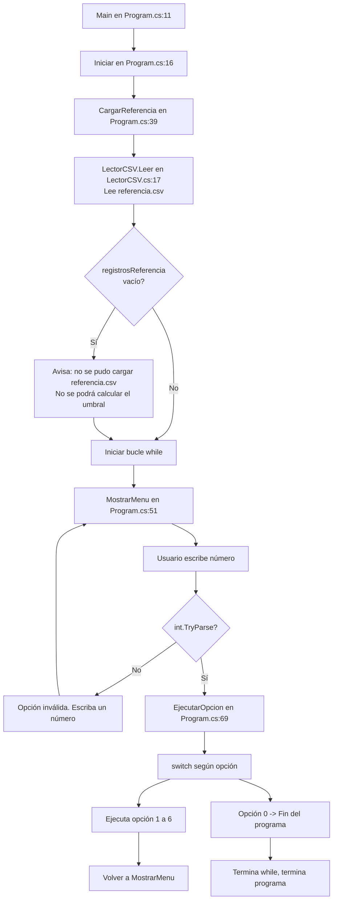
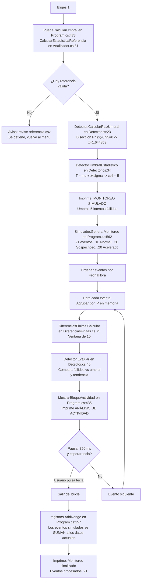
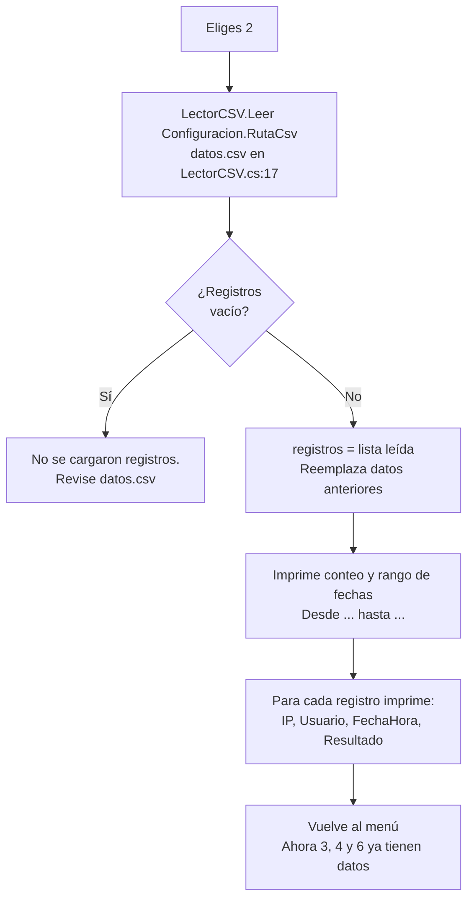
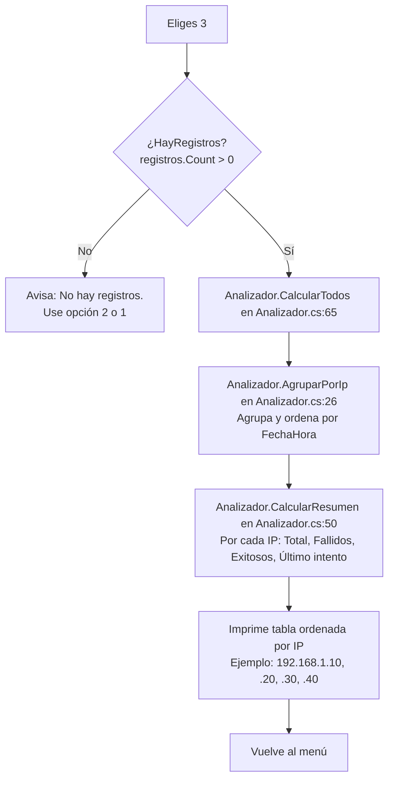
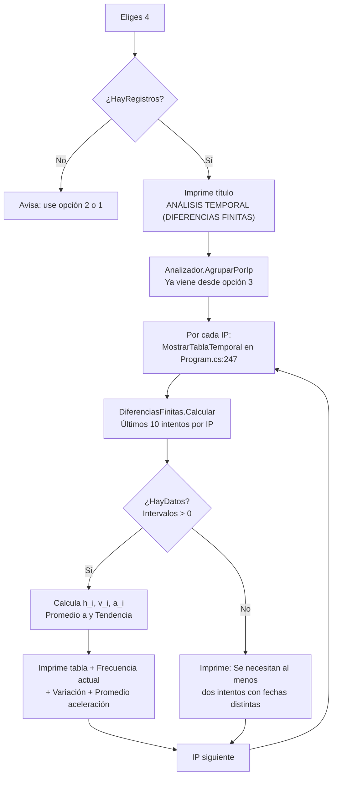
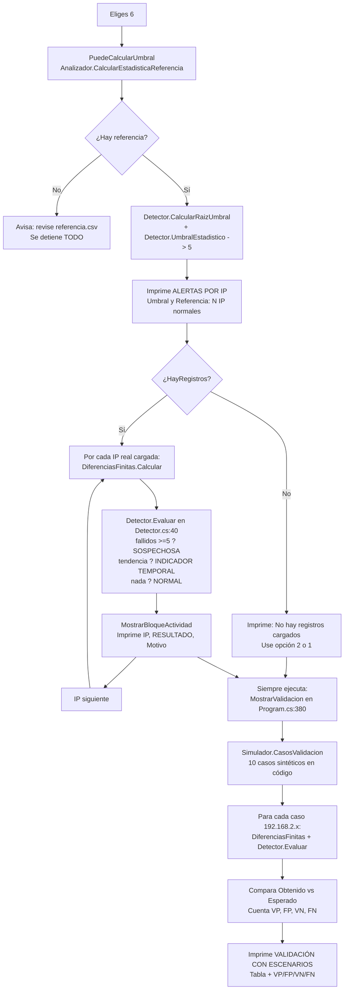
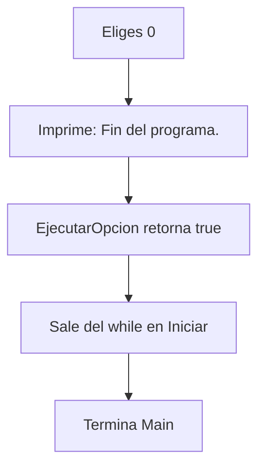

# Flujo de cada opción del menú

> Guía visual y paso a paso de qué ocurre cuando eliges cada número en el menú.
> Cada diagrama indica **qué función se llama, en qué archivo, y qué se imprime**.

## Flujo general del programa

Este flujo ocurre **una sola vez al iniciar**, antes de que elijas cualquier opción.



**En palabras:**

1.  Al arrancar se carga **siempre** `referencia.csv` para `mu` y `sigma`. No evita que el menú se abra, pero sin referencia no se puede calcular el umbral (opciones `1`, `5`, `6` quedan limitadas).
2.  Luego entra en un bucle infinito: muestra menú → espera número → ejecuta esa opción → vuelve a mostrar el menú.
3.  La lista `registros` (tus datos de análisis) empieza **vacía**. Solo se llena si eliges opción `2` o `1`.

---

## Opción 1 — Iniciar monitoreo simulado

Función: `Program.cs:101 IniciarMonitoreoSimulado()`
Salida: bloque `ANÁLISIS DE ACTIVIDAD` por cada evento + resumen al final.



**Paso a paso:**

1.  Verifica referencia. Sin referencia no se puede saber si 5 fallidos es mucho o poco, por eso se detiene.
2.  Calcula el umbral con Bisección (`1.644853 * sigma + mu`).
3.  Genera 21 eventos sintéticos en código (`Simulador.CrearNormal / CrearSospechoso / CrearAcelerado`), **no** lee ningún CSV.
4.  Para cada evento, recalcula su IP con diferencias finitas y evalúa la alerta. Es un análisis **en tiempo real**, evento a evento.
5.  Al final, todos esos 21 eventos se agregan a `registros`. Por eso después puedes verlos con las opciones 3, 4 y 6.

---

## Opción 2 — Cargar registros CSV

Función: `Program.cs:163 CargarCsv()`
Salida: tabla `REGISTROS LEÍDOS`.



**Paso a paso:**

1.  Lee `datos.csv` línea por línea con `LectorCSV.ConvertirLinea` (omite encabezado y líneas vacías, avisa si una línea es inválida).
2.  Si encuentra 0 registros útiles, no cambia nada. Si encuentra registros, **reemplaza** `registros` (no agrega).
3.  No calcula nada más: solo carga y muestra. Las opciones 3, 4 y 6 hacen los cálculos.

---

## Opción 3 — Consultar estadísticas

Función: `Program.cs:198 MostrarEstadisticas()`
Salida: tabla `ESTADÍSTICAS POR IP`.



**Paso a paso:**

1.  Si no cargaste CSV ni simulaste, se detiene con aviso.
2.  Agrupa los registros por IP.
3.  Cuenta los `FALLIDO` y `EXITOSO` de cada grupo. No mira tiempos ni frecuencias.
4.  Imprime la tabla. Es estadística descriptiva pura.

---

## Opción 4 — Ver análisis temporal

Función: `Program.cs:223 MostrarAnalisisTemporal()`
Salida: tabla por IP con `t(s)`, `h(s)`, `v(int/s)`, `a`.



**Paso a paso:**

1.  Toma los registros ya cargados y los agrupa por IP.
2.  Para cada IP, se queda solo con los **10 últimos intentos** (ventana móvil).
3.  Calcula `h`, `v`, `a`. Si `h <= 0` (misma hora), descarta ese intervalo para no dividir entre cero.
4.  Si el promedio de `a` es positivo → `Variación: Positiva` = `TendenciaCreciente = true`. Eso es lo que luego usa la opción 6.
5.  Imprime una tabla por IP. No decide aún si es normal o sospechosa, solo muestra el comportamiento temporal.

---

## Opción 5 — Comparar métodos numéricos

Función: `Program.cs:294 CompararMetodos()`
Salida: tabla de comparación Bisección vs Newton + umbral.

```mermaid
flowchart TD
    A["Eliges 5"] --> B["Define ecuación:<br/>Phi(x) - 0.95 = 0<br/>con Configuracion.NivelConfianza"]
    B --> C["MetodoBiseccion.Calcular en MetodoBiseccion.cs:32<br/>Intervalo [-6, 6]")
    B --> D["MetodoNewton.Calcular en MetodoNewton.cs:8<br/>x0 = 0, derivada phi(x)"]
    C --> E["Resultado Bisección<br/>x=1.644853, 24 it, error 7.15e-7"]
    D --> F["Resultado Newton<br/>x=1.644853, 6 it, error 2.08e-8"]
    E --> G["Imprime tabla COMPARACIÓN<br/>Método | Valor | Iteraciones | Error | Convergió"]
    F --> G
    G --> H["Calcula diferencia entre valores<br/>y diferencia de iteraciones"]
    H --> I{¿Hay referencia<br/>válida?}
    I -->|No| J[Salta cálculo T, vuelve al menú]
    I -->|Sí| K["Detector.UmbralEstadistico<br/>T = mu + x*sigma, ceil = 5"]
    K --> L["Imprime T y umbral entero"]
    L --> M[Vuelve al menú]
```

**Paso a paso:**

1.  No necesita `datos.csv`. Solo trabaja sobre la ecuación matemática.
2.  Los dos métodos resuelven **la misma ecuación** para obtener `x = 1.644853` (percentil 95).
3.  Compara velocidad: Newton gana en iteraciones (6 vs 24), Bisección gana en seguridad (solo necesita cambio de signo).
4.  Si hay referencia, usa ese `x` para calcular `T = mu + x·sigma`. Con tu `referencia.csv`: `mu=3.0`, `sigma≈0.894427`, `T≈4.47 → 5`.

---

## Opción 6 — Consultar alertas

Función: `Program.cs:336 MostrarAlertas()` + `Program.cs:380 MostrarValidacion()`
Salida: **dos bloques seguidos** (es la opción más importante de entender).



**Paso a paso dividido en dos partes:**

### Parte A — ALERTAS POR IP (tus datos reales)

1.  Calcula el umbral `5` desde `referencia.csv`.
2.  Si no hay registros cargados, avisa y **salta esta parte** (pero no la otra).
3.  Para cada IP real (las de `datos.csv` o las simuladas de la opción 1), calcula diferencias finitas y clasifica:
    *   `fallidos >= 5` → `ACTIVIDAD SOSPECHOSA`
    *   `tendencia creciente` y `< 5` → `INDICADOR TEMPORAL SOSPECHOSO`
    *   ninguno → `ACTIVIDAD NORMAL`
4.  Imprime cada bloque con `Motivo`.

### Parte B — VALIDACIÓN CON ESCENARIOS (casos sintéticos)

1.  **Siempre** se ejecuta, tengas o no CSV cargado.
2.  Usa 10 casos **inventados en código** (`Program.cs:571-612`):
    *   `Normal`: `192.168.2.11` a `.14` (2 fallidos cada 60 s) → esperado `ACTIVIDAD NORMAL`
    *   `Sospechoso`: `192.168.2.31` a `.33` (9 fallidos en 10 s → 0.5 s) → esperado `ACTIVIDAD SOSPECHOSA`
    *   `Acelerado`: `192.168.2.51` a `.53` (4 fallidos, intervalos 4 s, 2 s, 1 s, 0.5 s) → esperado `INDICADOR TEMPORAL SOSPECHOSO`
3.  Los pasa por el mismo motor (`DiferenciasFinitas` + `Detector.Evaluar`) y compara esperado vs obtenido.
4.  Imprime la tabla con `Correcto: Sí/No` y al final los conteos `VP/FP/VN/FN`.

> **Por eso en la opción 6 ves IP que no están en ningún CSV:** no es un error de lectura, es la Parte B que no depende del CSV.

---

## Opción 0 — Salir

Función: `Program.cs:91-93` dentro de `EjecutarOpcion()`



**Paso a paso:**

1.  No hace ningún cálculo ni guarda nada (todo está en memoria).
2.  Es la única opción que rompe el bucle del menú.

---

## Tabla resumen de dependencias

| Opción | Lee `datos.csv` | Lee `referencia.csv` | Genera datos | Decide alerta |
|---|---|---|---|---|
| 1 | No | **Sí** (umbral) | **Sí** (21 eventos) | Sí, en tiempo real |
| 2 | **Sí** | No | No | No |
| 3 | No, usa memoria | No | No | No, solo cuenta |
| 4 | No, usa memoria | No | No | No, solo tendencia |
| 5 | No | **Sí** (solo para umbral) | No | No, solo compara métodos |
| 6 Parte A | No, usa memoria | **Sí** | No | **Sí** |
| 6 Parte B | No | **Sí** (umbral) | **Sí** (10 casos sintéticos) | **Sí** (prueba interna) |
